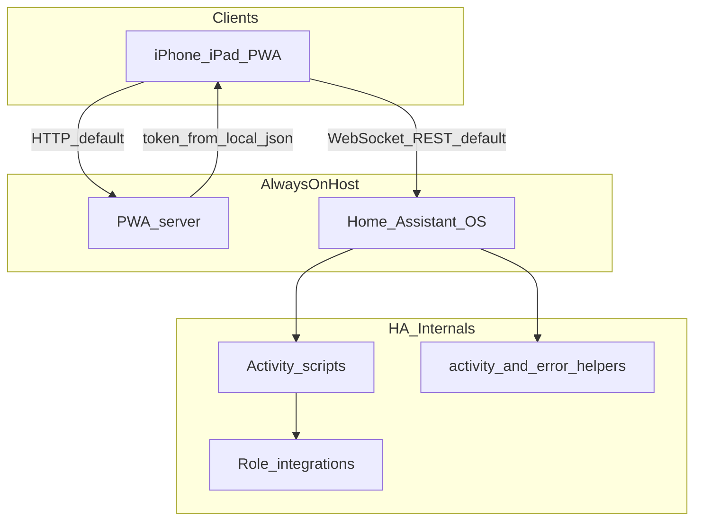

# Home Assistant Stack Plan

This plan defines the work required to produce a running Home Assistant Operating System (HAOS) instance and to attach theater components chosen for the rack. Brand, model, entity IDs, and sequence literals for worked stacks are documented under [`examples/`](examples/) (projector sample: [`jvc-lumagen-onkyo/`](examples/jvc-lumagen-onkyo/README.md); TV + AVR + streamer: [`appletv/`](examples/appletv/README.md)), not in this file.

**Status:** Progressive web application (PWA) template is present. HAOS, integrations, helpers, and activity scripts are adopter work.  
**PWA:** progressive web application — the LAN web UI in `pwa/`. Safari Add to Home Screen launches it as a standalone app; it is not an App Store binary. Contract: [`pwa/README.md`](pwa/README.md).

## Scope

| In scope |
|----------|
| HAOS on the same LAN as the rack and PWA host |
| Discovery and install of Core or HACS integrations for each theater role |
| Helpers, activity scripts, and the wake method each source requires |
| Serial power-on and reverse shutdown owned by HA scripts |
| Alignment of `pwa/config.js`, `pwa/contracts.json`, device sheets, and the script publisher |

Device I/O remains in Home Assistant integrations and scripts. This repository does not implement vendor protocols. The PWA waits on [`pwa/contracts.json`](pwa/contracts.json). A facts JSON DSL for sheets is not part of this work.

## Target Architecture



The phone-to-host edges in the diagram are plain HTTP. That is the default. [TLS](#tls) replaces both edges together.

| Layer | Owner | Change surface |
|-------|--------|----------------|
| Device protocols | HA Core / HACS | None in this repo |
| Entity state | HA | `pwa/config.js` `roles` |
| Verify/retry activities | HA scripts | Profile publisher under `examples/` (or a new profile directory) |
| Expected state for the UI | PWA | `pwa/contracts.json` |
| Theater UX | PWA | `pwa/` including `sheets/` and home decks in `index.html` |

HAOS may run as a VM, a dedicated appliance, or Home Assistant OS on bare metal. Minimum allocation is 2 GB RAM and 2 vCPUs; the practical allocation is 4 GB RAM and 4 vCPUs. The PWA host is a separate always-on process (`python pwa/serve.py` or `theater-ui.service.example`). Install-method options and **backup** (target-agnostic; automation patterns) are stubbed in [`docs/HOME_ASSISTANT.md`](docs/HOME_ASSISTANT.md)—configure scheduled HA backups and an off-host copy before treating the rack as production.

Roles are declared in `THEATER_CONFIG`. Typical roles are `display`, optional `processor`, `avr`, and one or more sources. Role keys, activity labels, and entity IDs are chosen to match the rack.

## Home Assistant Operating System

1. Install HAOS on the theater LAN. Confirm `http://homeassistant.local` (or the assigned HTTP URL) responds.
2. Create a long-lived access token. Define it in repository-root `local.json` with `haUrl`. Do not commit `local.json`.
3. Install [HACS](https://hacs.xyz/).
4. For each rack role, follow [Driver Discovery](#driver-discovery) and add the integration.
5. Create helpers in [Helpers](#helpers). Options on the activity helper must match activity labels in `pwa/config.js`.
6. Map entity IDs in `pwa/config.js` `roles`, `activities`, `scripts`, `helpers`, and `pills`.
7. Write `pwa/contracts.json` required and warn checks for Idle and each activity label.
8. Implement and publish activity scripts (power-on, source switch, shutdown, resync) per [Activity Scripts](#activity-scripts). A worked publisher is in the sample profile directory.
9. Add or replace `pwa/sheets/*.js` and home decks so pill `id` values and source remotes match the devices.
10. Start `python pwa/serve.py`. Confirm `/auth.json` returns `haUrl` and a token. Install the PWA from Safari on the LAN.

An agent that is reproducing the committed sample stack follows [`examples/jvc-lumagen-onkyo/README.md`](examples/jvc-lumagen-onkyo/README.md) after step 3.

## TLS

Plain HTTP on the theater LAN is the default. Use TLS when the Wi-Fi is shared with guests, another VLAN can route to the hosts, or either service is reached from outside the LAN. The phone talks to two listeners: the PWA host (`/auth.json` and the page) and Home Assistant (the WebSocket). Set both to HTTPS together. One without the other leaves the long-lived token in the clear.

Home Assistant TLS is set under **Settings → System → Network → HTTP server**: SSL certificate path and SSL key path, for example `/ssl/fullchain.pem` and `/ssl/privkey.pem` ([HTTP integration](https://www.home-assistant.io/integrations/http/)). As of Home Assistant 2026.8 that screen is the place to set it. An older `http:` block in `configuration.yaml` is imported on upgrade and should then be removed. If the certificate file is missing, Home Assistant falls back to the last working HTTP settings so you can still reach it.

`pwa/serve.py` does not terminate TLS. A reverse proxy on the PWA host presents the certificate and forwards to that process. `haUrl` in `local.json` and the printed page URL both use `https` only when both listeners do. Do not port-forward either listener without TLS ([Remote access](https://www.home-assistant.io/docs/configuration/remote/)).

### Public CA

[Let's Encrypt](https://letsencrypt.org/about/) issues the certificate at no charge to anyone who controls a domain name. The cost is the registrar's annual fee for that name, not the certificate. Phones already trust it. The certificate is valid only for the names on it, so `homeassistant.local` and a bare IP produce a warning. An HTTP challenge requires the certificate authority to reach port 80 from the internet. Do not open that port for this app. A DNS challenge can issue a certificate for a name that resolves only inside the house. Certificates last 90 days and have to be renewed. On HAOS, the Let's Encrypt add-on writes the files the HTTP settings point at. A commercial certificate adds cost and does not change the outcome.

### Private CA

A private CA is software you run. There is no registrar fee. You choose the names and the lifetime. An iPhone trusts it only after the root is installed as a configuration profile and full trust is enabled for that root. Every new phone repeats that step. A root with full trust can sign a certificate for any name that phone visits. A phone that never received the root shows a certificate warning.

### Home Assistant Link

[Home Assistant Link](https://www.nabucasa.com/link/) (formerly Home Assistant Cloud) is a tunnel to Home Assistant from outside the house. Traffic on that tunnel is encrypted, and no port is opened on the router. In the United States the subscription is $6.50 per month or $65 per year, tax excluded. Other regions are listed on the [pricing page](https://www.nabucasa.com/pricing/). Link does not certificate the LAN PWA, and a phone that stays on the LAN does not need it.

## Driver Discovery

Hardware is attached through a Home Assistant integration. The PWA and activity scripts consume entity IDs and services; they do not load vendor SDKs.

### Search Path

Search in this order until power, state, and the role’s required services exist as HA entities.

| Order | Surface | Use |
|-------|---------|-----|
| 1 | [Home Assistant integrations catalog](https://www.home-assistant.io/integrations/) | Brand, model, and protocol (PJLink, eISCP, HDMI-CEC, DLNA, IP control, serial-over-TCP). Core integrations are preferred when they cover power and state. |
| 2 | HA **Devices & services** → **Add integration** | LAN discovery and official config-flow names after Core/HACS install. |
| 3 | [HACS](https://hacs.xyz/) → Integrations | Manufacturer and model search. Default HACS stores first; a custom GitHub repository is added only when the default store has no candidate. |
| 4 | GitHub / HA Community | Query `homeassistant` plus model or protocol. Confirm the repo exposes a `custom_components/` layout and a recent Core version. |
| 5 | Host one-shot (last) | A small proxy under `pwa/` when HA has state and power but omits one OSD or IR command. Vendor protocol stacks are not added to this repo. |

Catalog filters that match theater roles: Projector, Media player, Remote, Switch, Select. Device protocol docs (LAN port, serial settings, Network Standby, Wake-on-LAN) determine whether an integration stays connected after standby.

### Role Requirements

A candidate driver is usable when it exposes the services and state the scripts and contracts will assume for that role. Entity IDs may differ; domains and behavior must match or the scripts must be rewritten to the new domain.

| Role | Required HA surface | Typical domains | Failure modes to check before adopting |
|------|---------------------|-----------------|----------------------------------------|
| `display` | Gated power on/off; power state including cooldown if the lamp or laser requires it; optional input `select` | `remote`, `sensor`, `select` | `turn_on` during cooling; state stuck `unknown`; input names that differ from the sheet |
| `processor` | Power with honest on/off; input select with a confirmable state; optional memory or style | `switch`, `select`, `sensor`, `button`, `remote` | Single-client TCP/serial bridges that drop after standby; `turn_on` no-op while `unknown` |
| `avr` | Power, volume, source, listening mode; source string for contracts | `media_player` | Session drop in standby; `turn_on` while `unavailable`; source labels with vendor punctuation |
| Source | Power; remote commands if a home deck is required; state that distinguishes off from idle or play | `media_player`, `remote`, optional `button` (WoL) | `turn_on` implemented as a power toggle; deep-off that HA cannot wake; a second sleep or reboot command that powers down |

A rack may omit `processor` when the display or AVR performs switching. Sheet extras (picture mode, HDR sensors, setup keys) are optional. Activities must still reach a contract-true state using only the required surface.

### Integration Path

1. Name the role (`display`, `processor`, `avr`, or a source key).
2. Follow [Search Path](#search-path). Record the integration domain, catalog or GitHub URL, and the entity IDs HA creates.
3. In Developer Tools → States, confirm power, source or input, and remote commands against [Role Requirements](#role-requirements).
4. Install the integration (Core UI or HACS, then restart if HACS requires it).
5. Point `pwa/config.js` `roles` and `pills` at those entities.
6. Encode power, wait, retry, and `fail_if` steps in the activity publisher for that profile.
7. Rewrite `pwa/contracts.json` expected `state` / `state_in` / `not_state` / `source_contains` for the new labels.
8. Add `pwa/sheets/<device>.js` registered as `TheaterSheets.<pill id>`, a matching `<script>` tag before `app.js`, and a home deck in `index.html` when the source needs transport or pad controls.
9. Apply device constraints the driver documents (Network Standby, sleep policy, serial settings, firmware). Encode waits and `homeassistant.reload_config_entry` where the transport drops after standby.
10. Publish scripts and verify per [Verification](#verification).

HACS custom components update on the HACS cadence. Core integrations follow Home Assistant Core. Breaking entity-ID or service-name changes require the same coordinated replace as a hardware swap.

## Helpers

| Helper | Purpose |
|--------|---------|
| Activity `input_select` | Last requested activity. Options equal the Idle label plus each `THEATER_CONFIG.activities[].label`. Resync reads this entity. |
| Last error `input_text` | Scripts write a failure string; a single space `" "` clears. The PWA treats a non-empty trim as a failed settle. |

Entity IDs are declared in `pwa/config.js` under `helpers`. A rename in HA requires the same rename in config.

## Activity Scripts

Each home activity is an HA script invoked with `script.turn_on`. Shutdown and Resync are header actions with their own script IDs in `THEATER_CONFIG.scripts`.

| Script | Responsibility |
|--------|----------------|
| Per-activity | Serial power-on of display → processor (if present) → AVR → that source; route inputs; `fail_if` when contracts cannot be met |
| Shutdown | Reverse order; skip any step already off; set activity helper to Idle |
| Resync | Turn on the script that matches the current activity helper option |

Script `mode` is `restart` unless overlapping runs are explicitly designed. Concurrent activity invocations are not supported.

Check-then-change: read entity state, issue an absolute command only when mismatched, wait for confirmation, retry, then write `helpers.error` and a persistent notification on failure. Optimistic “command sent, success assumed” sequences are excluded.

Site-specific strings (MAC, broadcast, AVR source label) belong in a gitignored or example `profile.json` next to the publisher, not in the PWA.

## Sequence Pattern

Power-on is serial. Shutdown is the reverse and skips any step already off.

1. Wait until shutdown is `off` (continue on timeout).
2. Display: wait out cooldown; power on; wait until power is accepted (`warming` or `on`), not full ready; set a fixed input when switching is performed at the processor.
3. Processor (optional): reload the config entry if state is `unavailable`/`unknown`; power on; wait for I/O; settle delay; select the activity’s input and memory until confirmable sensors match.
4. AVR: reload if `unavailable`; power on; select the activity’s source; optional default listening mode. Late lock is allowed when contracts only require a source substring.
5. Inactive sources: sleep or power off only with commands that do not deep-shutdown a device HA cannot wake. Active source: wake or power on; wait until not off.
6. Repeat processor routing after the source so a late HDMI lock cannot restore the last-boot input. Retry the display’s fixed input if select during warmup did not stick.
7. `fail_if` against the same facts `contracts.json` requires for that activity label.

The PWA does not start shutdown when Idle required checks already pass.

## Sequence Modification

Power order and retries are functions in the profile’s `publish_activity_scripts.py` (or equivalent YAML). After edits, republish to HA. Align `pwa/contracts.json` so the UI progress banner dismisses on the new expected state.

| Change | Publisher | Also update |
|--------|-----------|-------------|
| Power-on device order | Power-on chain | Idle and activity `required` checks if readiness order is observable |
| Shutdown device order | Shutdown sequence | Idle `required` checks |
| Display input | Display ensure-on | `fail_if`; optional `displayInput` contract |
| Processor input / memory | Route helper | `processorInput` / `processorMemory` contracts |
| AVR source string | Profile or constant | contracts `source_contains` |
| Source wake / sleep policy | Source functions | Play/Watch `required` and Idle `warn` |
| Retry counts / delays | `wait` / retry helpers | Empirical settle after standby |
| Entity IDs in templates | Publisher literals | `pwa/config.js` `roles` |

## Component Addition

A new physical device is a coordinated change across the HA integration, the publisher, config, contracts, and often a sheet. Driver selection is [Driver Discovery](#driver-discovery).

| Addition | Publisher | `pwa/config.js` | `pwa/contracts.json` | UI |
|----------|-----------|-----------------|----------------------|-----|
| Display, processor, or AVR | Ensure-on / off / route for that role | `roles` plus a `pills[]` entry | Idle and activity checks for that role | `pwa/sheets/<id>.js` registered as `TheaterSheets.<id>` |
| Source | Source function + `fail_if` | `activities[]`, source roles, pill | New activity label key | Stage deck (`data-deck`) per [`docs/ACTIVITY_DECKS.md`](docs/ACTIVITY_DECKS.md) |
| Drop a source | Remove source function | Remove activity and pill | Remove activity key | Hide or remove that deck |

Sheets register as `TheaterSheets.<pill id>`. Power and routing remain in scripts.

Duplicate `examples/jvc-lumagen-onkyo/` or start from [`examples/appletv/`](examples/appletv/README.md) (LG C3 + Denon, no processor) into a new `examples/<stack>/` directory when keeping samples intact. Point `pwa/config.js` and `pwa/contracts.json` at the new map.

## Activity Addition

1. Implement and publish a Home Assistant script (`mode: restart` unless overlap is designed).
2. Append `{ id, label, script, icon, deck }` to `THEATER_CONFIG.activities`.
3. Add a `contracts.json` key equal to `label`, using `state`, `state_in`, `not_state`, and `source_contains`.
4. Add the label to the activity helper options.
5. Extend the Resync choose-branches for the new label.
6. Add a home deck in `index.html` when `deck` is a new source surface.

Shutdown and Resync remain special-cased in the PWA header.

## Resync Script

The PWA header Resync action calls `CFG.scripts.resync`. Publish a script that turns on the last activity script from the activity helper. Each `choose` branch state must equal an activity `label`.

```yaml
alias: Theater Resync
icon: mdi:refresh
mode: restart
sequence:
  - choose:
      - conditions:
          - condition: state
            entity_id: input_select.theater_activity
            state: ACTIVITY_LABEL
        sequence:
          - action: script.turn_on
            target:
              entity_id: script.ACTIVITY_ID
```

Repeat a branch per activity. Encode the same structure in the publisher’s `put_script` for resync.

## PWA Alignment

| Concern | Rule |
|---------|------|
| Progress banner | Hidden when the current activity’s `required` checks all pass, or after 3 minutes (then Resync) |
| Last-error helper | Non-empty trim ends settling and surfaces failure |
| Help | Shown only when `roles.lumagenRestart` is set; presses that button (output restart). Omit the role when no Lumagen is in the chain. |
| Volume | `media_player` volume services on `roles.avr` when the AVR is on |
| Token | `/auth.json` from `local.json` only |

## Verification

```text
npm test
python tests/test_onkyo_osd.py
```

On a live HAOS instance, confirm each activity, activity switch, Shutdown, and idle-skip Shutdown without overlapping scripts. jsdom tests in this tree use placeholder URLs and do not power equipment. Profile-specific publish commands are listed in the example README.
