# Home Theater IP Control

This repository contains Home Theater IP Control, a LAN page that starts one home-theater activity through Home Assistant and reports whether each device reached the required state.

<!-- Agents: generic HAOS stand-up, driver discovery, and sequences → PLAN.md. HA install options + backup → docs/HOME_ASSISTANT.md. Sample JVC/Lumagen/Onkyo/Xbox/Panasonic → examples/jvc-lumagen-onkyo/README.md. Alternate LG C3/Denon/Apple TV → examples/appletv/README.md. Activity deck button layouts → docs/ACTIVITY_DECKS.md. -->

## Control Models

Three common approaches start a room. Separate device apps and remotes require a manual sequence. An infrared activity remote (Harmony, SofaBaton, and similar) runs a timed macro and does not read whether the display is still warming, the processor remains on the last input, or the source is asleep. A dealer control system (Crestron, Control4, and similar) sequences devices and reads state; that system is priced and programmed as an installed system. A home scene turns devices on and does not route inputs or present the controls for the source that started.

## Operation

The page shows only the controls for the selected activity. Devices are reached through Home Assistant. A theater rack and a living room use the same shell.

The page is HTML, CSS, and JavaScript served on the LAN, with `manifest.webmanifest` and icons, so a phone can add it to the Home Screen and open it full screen. Device protocols are defined in Home Assistant integrations and scripts. The page calls `script.turn_on`, shows entity state, and sends volume and remote commands over the Home Assistant WebSocket. The UI is under [`pwa/`](pwa/README.md). Safari installation is Share → Add to Home Screen → Open as a Web App ([Installation](#installation)).

## IP Control

IP control applies when Home Assistant can reach the devices over the network, including a documented serial-to-Ethernet bridge. Infrared sends commands in one direction: power and input have no readback, delays are fixed intervals, and the blaster requires line of sight. IP control is two-way. Power and input are discrete commands, status pills and activity checks read current state, and volume is a level. A script waits until a device is on. One phone reaches the room with no line of sight to the equipment.

## Framework Scope

The repository is an extensible framework. Committed samples demonstrate the shell against concrete racks. The samples do not bound the supported hardware set.

| Sample | Path |
|--------|------|
| JVC projector, Lumagen processor, Onkyo AVR, Panasonic disc, Xbox | [`examples/jvc-lumagen-onkyo/`](examples/jvc-lumagen-onkyo/) and default [`pwa/config.js`](pwa/config.js) |
| LG OLED C3, Denon AVR, Apple TV (no Lumagen) | [`examples/appletv/`](examples/appletv/) |

Extension adds activities, decks, device sheets, contracts, and Home Assistant sequences.

| Layer | Extension surface |
|-------|-------------------|
| Activities and roles | `pwa/config.js`, `contracts.json` |
| Stage remotes | `data-deck` panels; [`docs/ACTIVITY_DECKS.md`](docs/ACTIVITY_DECKS.md) |
| Device diagnostics | `pwa/sheets/*.js` and `pills` |
| Rack stand-up and sequences | [`PLAN.md`](PLAN.md) and a profile under [`examples/`](examples/) |

A new profile or deck supersedes a fork of the UI core. This README specifies repository intent, layout, PWA installation, and short extension steps. Detailed extension guidance is defined in [`PLAN.md`](PLAN.md), [`docs/ACTIVITY_DECKS.md`](docs/ACTIVITY_DECKS.md), and the example READMEs.

A different rack is produced by duplicating a profile and replacing role entity IDs, device sheets, and activity scripts.

## Home Assistant Prerequisite

A Home Assistant instance on the theater LAN is required. This repository does not install Home Assistant. Install-method options (HAOS on bare metal, VM, official appliance, or Container) and backup practices (artifacts, target-agnostic destinations, automation patterns) are defined in [`docs/HOME_ASSISTANT.md`](docs/HOME_ASSISTANT.md). HAOS provides Supervisor backups and add-ons with the fewest external dependencies. After Home Assistant responds on the LAN, integrations, helpers, and activity scripts follow [`PLAN.md`](PLAN.md).

## Agent Plan

Automated HAOS stand-up, driver discovery, and activity sequences for an arbitrary rack are defined in [`PLAN.md`](PLAN.md). Implementing agents use that file, then attach the chosen components. Brand-specific literals for the projector sample are in [`examples/jvc-lumagen-onkyo/README.md`](examples/jvc-lumagen-onkyo/README.md). Literals for the TV, AVR, and streamer sample are in [`examples/appletv/README.md`](examples/appletv/README.md).

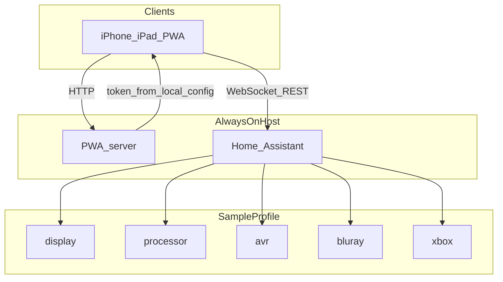

## Sample Interface

The sample JVC / Lumagen / Onkyo / Panasonic / Xbox / Apple TV profile is shown on an iPhone-width viewport. Activity tiles read Blu-Ray, Streaming, and Xbox. Home is the Xbox activity: status pills, the Xbox pad (Home / Menu / Apps), and volume. Streaming replaces the Xbox pill with Apple TV and shows the Apple TV deck. A header Settings gear opens themes, favorites, and the app blacklist. Apps opens the Xbox app switcher with logo-normalized tiles. A status pill opens a device sheet (Xbox includes LB / RB / Guide / Settings). Shutdown uses a confirmation modal.

| Home | Apps |
|:----:|:----:|
|  | 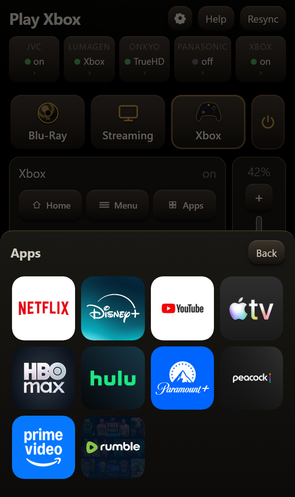 |
| **Xbox sheet** | **Settings** |
|  | 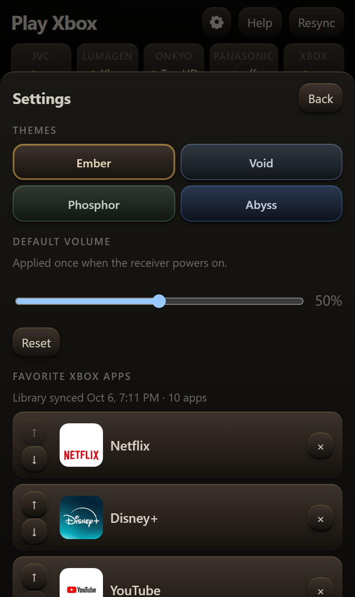 |
| **Onkyo sheet** | **JVC sheet** |
| 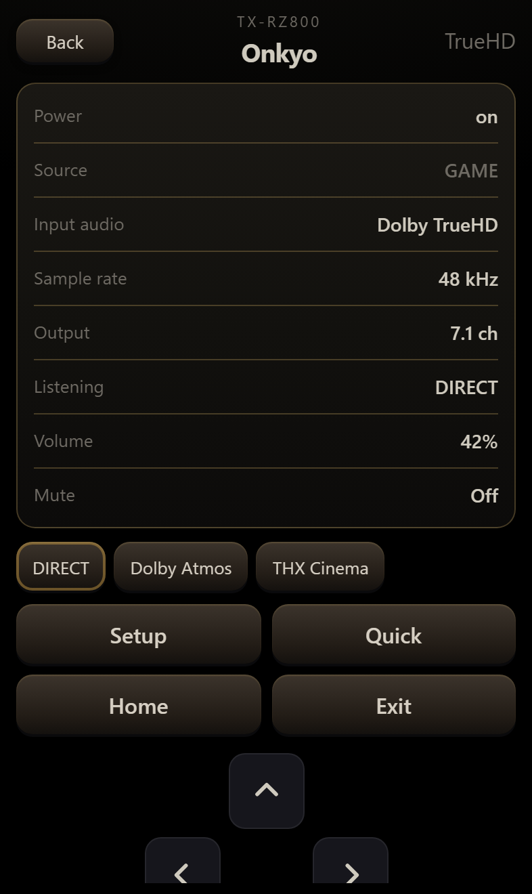 | 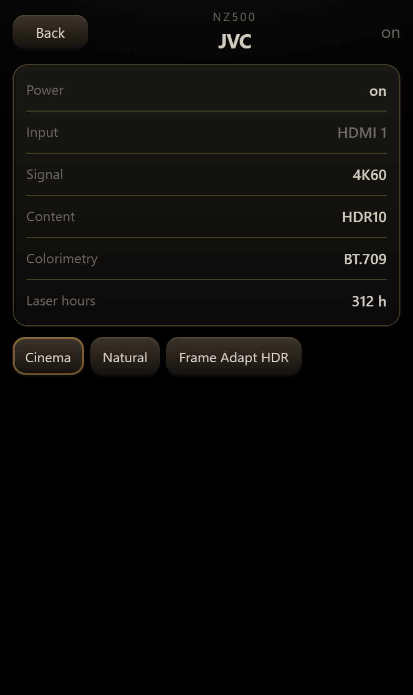 |
| **Shutdown** | **Streaming** |
| 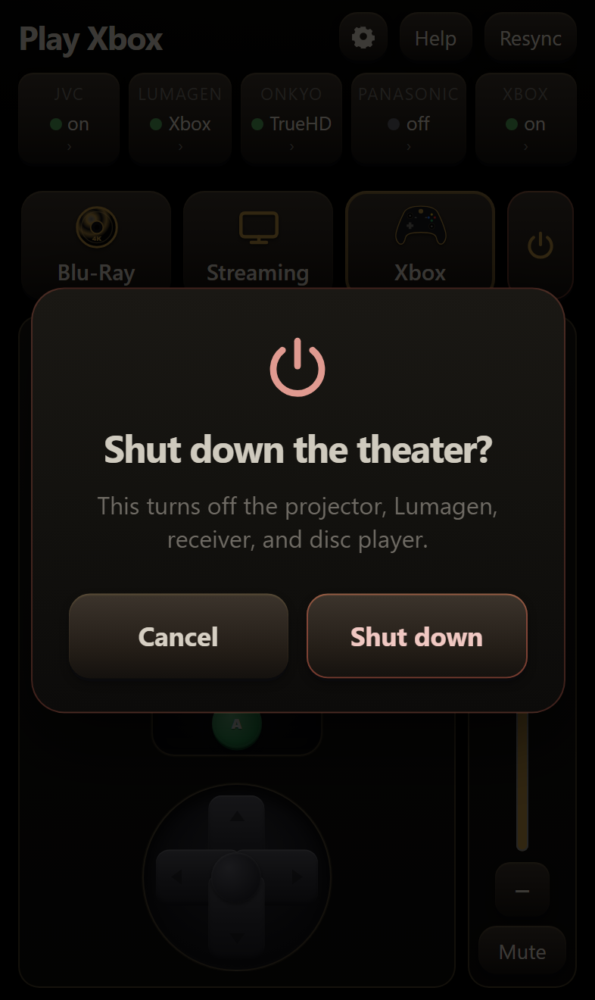 | 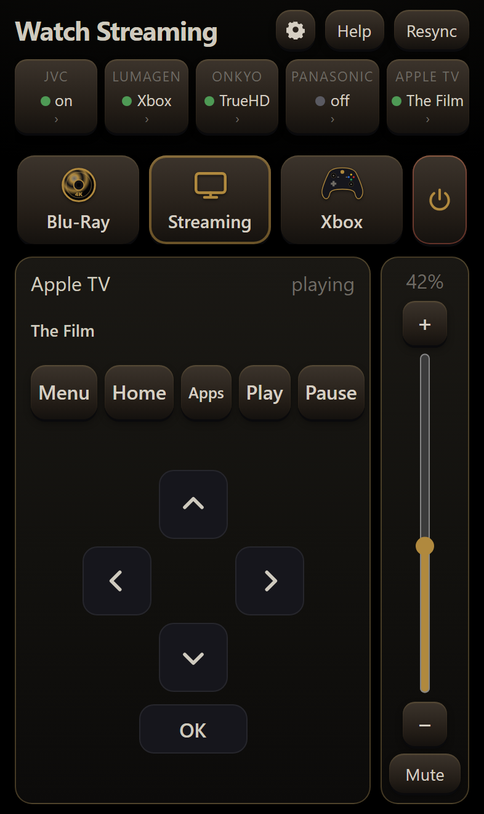 |

| Ember | Void | Phosphor | Abyss |
|:-----:|:----:|:--------:|:-----:|
| 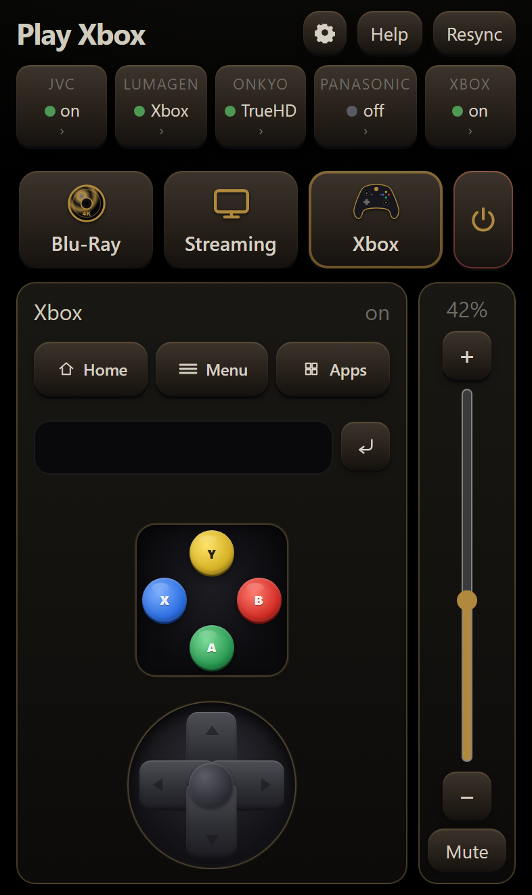 | 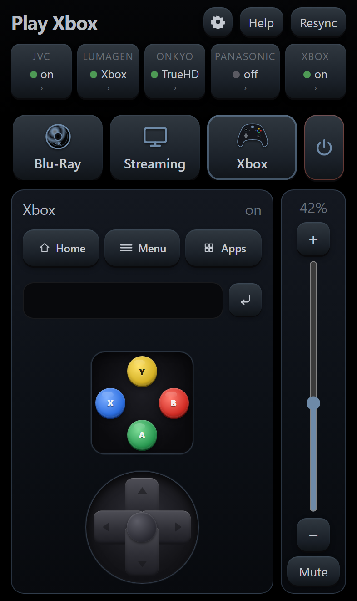 | 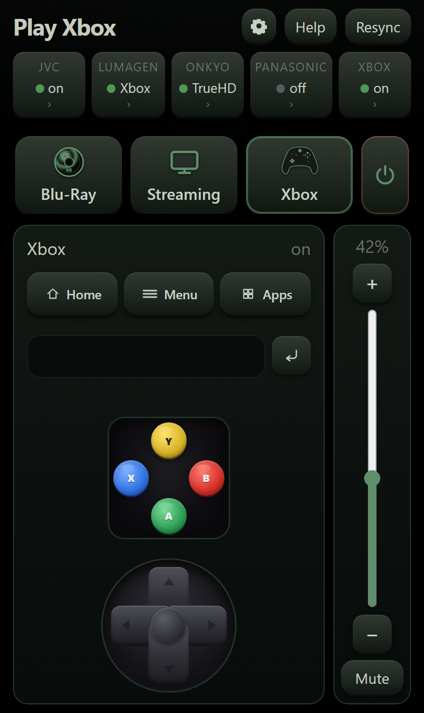 | 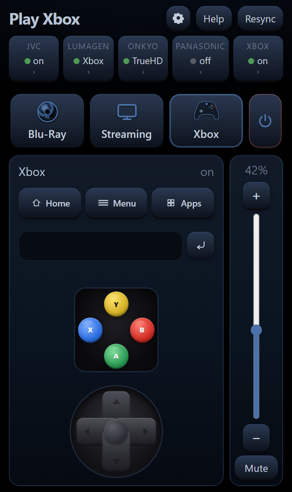 |

## Trust Model

The default is HTTP on a closed LAN. The phone, the PWA host, and Home Assistant remain on that network, and no port is forwarded. Safari can add the page to the Home Screen over HTTP. The page has a manifest and no service worker, so that install path does not require TLS.

The Home Assistant long-lived access token is stored in gitignored `local.json` on the always-on host. It is not committed. The phone loads it from `/auth.json`, then opens a WebSocket to Home Assistant. Those are the two hops. A device already on the LAN can read the token. A device on the internet reads the token only when a port is forwarded.

TLS applies when the Wi-Fi is shared with guests, another VLAN can route to the host, or the page is reached from outside the LAN. Both hops use HTTPS, or both remain HTTP. HTTPS on only one hop leaves the token in the clear on the other. Port forwarding of either listener requires TLS on both hops. Steps for a public certificate authority, a private certificate authority, and Home Assistant Link are in [`PLAN.md`](PLAN.md#tls).

## Contents

| Path | Role |
|------|------|
| [`pwa/`](pwa/README.md) | Theater UI, host server, role map, contracts, device sheets |
| [`examples/jvc-lumagen-onkyo/`](examples/jvc-lumagen-onkyo/README.md) | Sample HA profile: JVC + Lumagen + Onkyo + disc + Xbox |
| [`examples/appletv/`](examples/appletv/README.md) | Alternate profile: LG OLED C3 + Denon + Apple TV (contracts, no Lumagen) |
| [`tests/`](tests/pwa) | jsdom UI tests and Onkyo eISCP framing tests |
| [`PLAN.md`](PLAN.md) | Agent plan: HAOS, driver discovery, generic roles and sequences |
| [`docs/screenshots/`](docs/screenshots) | Sample iPhone-width frames of home, Streaming, Apps, Settings, device sheets, shutdown, and themes |
| [`docs/ACTIVITY_DECKS.md`](docs/ACTIVITY_DECKS.md) | Agent playbook: activity-specific stage decks |
| [`docs/HOME_ASSISTANT.md`](docs/HOME_ASSISTANT.md) | HA install options and backup automation patterns |
| `local.example.json` | Template for gitignored `local.json` |
| `theater-ui.service.example` | systemd unit template for the PWA host |

## Installation

1. Copy `local.example.json` to `local.json`.
2. Set `haUrl` and a Home Assistant [long-lived access token](https://www.home-assistant.io/docs/authentication/).
3. Map `pwa/config.js` `roles` to Home Assistant entity IDs. For the sample stack, start from `examples/jvc-lumagen-onkyo/config.example.js`.
4. Create helpers `input_select.theater_activity` and `input_text.theater_last_error`, or replace those IDs in config.
5. Edit `examples/jvc-lumagen-onkyo/profile.json` (`xboxMac`, `wolButton`, `gameSource`, `broadcastAddress`).
6. Publish sample activity scripts:

   ```text
   python examples/jvc-lumagen-onkyo/publish_activity_scripts.py
   ```

7. Start the PWA host from the repository root:

   ```text
   python pwa/serve.py
   ```

8. On a phone on the same LAN, open the printed URL in Safari → Share → Add to Home Screen → Open as a Web App.

Optional host fields in `local.json`: `osdHost` / `osdPort` for the Onkyo Setup one-shot (`POST /onkyo-osd`); `publicUrl` for `/print-qr.html`. Optional: `pip install segno` so `/qr.svg` is generated. Optional: install `theater-ui.service.example` on the always-on host.

## Activity Extension

Shutdown and Resync are header actions (confirm dialog and last-activity replay). Home activity tiles are rendered from `THEATER_CONFIG.activities` (horizontal scroll for large activity counts; the power control is sticky outside the scrollport).

1. Append `{ id, label, script, icon, deck }` to `activities` in `pwa/config.js`, and add the matching `scripts` entry.
2. Add a `contracts.json` key equal to the activity `label`.
3. Publish the Home Assistant script.
4. When `deck` is new, add a `data-deck="…"` panel under `.stage` (duplicate the Xbox, transport, or Apple TV panel). Agent deck guidance: [`docs/ACTIVITY_DECKS.md`](docs/ACTIVITY_DECKS.md).
5. Increment the shared `?v=N` query after UI changes.

The header **Help** control presses `roles.lumagenRestart`. When that role is omitted (typical for racks without a Lumagen), the Help control is hidden.

Xbox pad commands use `remote.send_command` on `roles.xboxRemote`. Netflix on Xbox often ignores face and D-pad SmartGlass input while Home still works; that is a console and app limitation. Sample stack notes: [`examples/jvc-lumagen-onkyo/README.md`](examples/jvc-lumagen-onkyo/README.md#xbox-pad--netflix). An alternate living-room stack with a streamer that accepts the documented remote commands is [`examples/appletv/`](examples/appletv/).

The LG C3 + Denon + Apple TV profile with full contracts is defined under [`examples/appletv/`](examples/appletv/).

## Device Sheet Extension

1. Add `pwa/sheets/device.js` that assigns `TheaterSheets.device`.
2. Add a `pills[]` entry whose `id` matches that key.
3. Include `<script src="sheets/device.js?v=N"></script>` in `pwa/index.html` before `app.js`.

The sheet callback receives `st`, `esc`, `pretty`, `chip`, `factsBox`, `factRow`, and the sheet header elements. Power and routing are defined in activity scripts. Sheets present diagnostics and safe extras.

`renderSheet` in `pwa/app.js` calls `TheaterSheets` for `appletv`. JVC, Lumagen, Onkyo, Panasonic, and Xbox render from the inline functions in that file. A new pill id is included in that dispatcher before the sheet module renders.

## Verification

```text
npm install
npm test
npm run test:viewports
python tests/test_onkyo_osd.py
```

`npm test` runs jsdom unit tests (placeholder URLs `http://127.0.0.1:8765` and `http://homeassistant.local`). `npm run test:viewports` launches Playwright Chromium against several phone and tablet sizes and asserts ABXY and D-pad centers remain hittable after pad scaling. Playwright Chromium is installed once with `npx playwright install chromium`. `npm run test:all` runs both. Live-rack sequence tests and host backup scripts are omitted from this tree.

## License

The project is licensed under the MIT License. `local.json` is excluded from version control.
